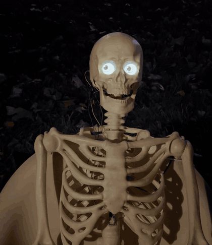
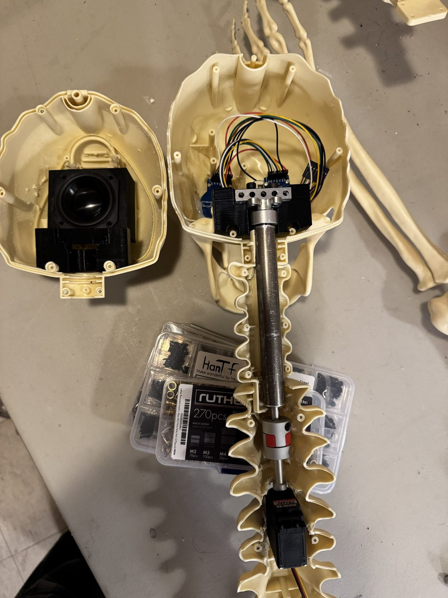
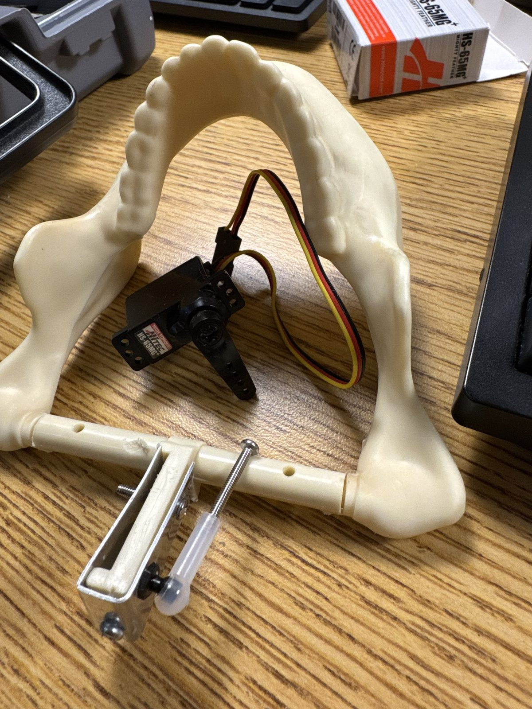
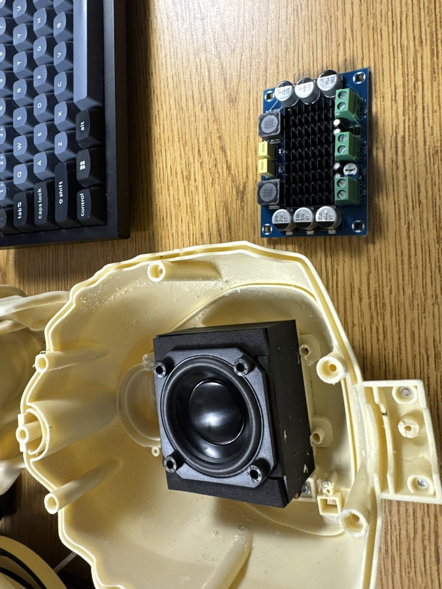

# Talking Skull 💀

An animatronic talking skull that notices people walking up, turns its head to look at them, and holds a real conversation. It hears visitors through a far-field mic array, thinks with Claude, and answers out loud in a theatrical villain's voice, with a servo-driven jaw synced to every syllable and lifelike animated eyes that glance, blink and narrow while it thinks.

It was built into a plastic Halloween skeleton for trick-or-treaters on Halloween 2026, where it was a hit. Next stop: Maker Faire Philadelphia.

> 🎬 A full build video is coming to YouTube, and the 3D-printable parts will be added to [`hardware/cad/`](hardware/cad/).

**Highlights**
- **Notices you before you speak.** A 24 GHz mmWave radar tracks up to three people. When someone steps into range, the eyes wake up with a blink, the head turns to follow them, and the skull greets them.
- **Real conversation.** Speech is transcribed on the Mac with Whisper, so no audio leaves the house. Claude writes the replies in character, and the skull starts speaking as soon as the first sentence arrives instead of waiting for the whole answer.
- **Family-friendly by design.** The persona is spooky-fun but never frightening or mean, compliments costumes extravagantly, and never asks for names, addresses or other personal details.
- **Jaw that actually talks.** The jaw opens once per syllable, wider for louder ones, and moves slightly ahead of the audio to make up for servo travel time.
- **Eyes that look alive.** Original procedurally generated eyes with a polar-mapped iris, so the pupils dilate and contract smoothly. The eyes lead the head toward a visitor, glance up and aside while "thinking," hold steady while listening, and blink at natural intervals.
- **Runs itself.** One double-click (or a Login Item) starts it, it restarts on crashes, and it waits for the next group to leave before greeting again.

<p align="center"></p>

## How it works

```
 LD2450 radar ──UART──▶ ESP32-S3 ◀──USB serial──▶ Mac mini (M4)
                          │                            │
        jaw servo ◀───────┤                            ├── USB mic array ──▶ Whisper (MLX, on-device STT)
        neck servo ◀──────┤                            ├── Claude API (Haiku) — skull persona
        2× GC9A01 eyes ◀──┘                            └── macOS `say` TTS ──▶ amp ──▶ 2" speaker
```

1. The **LD2450 mmWave radar** spots a visitor and reports their position.
2. The **ESP32-S3** wakes the eyes, turns the neck to track the visitor, and tells the Mac someone is there.
3. The **Mac mini** greets the visitor, listens through the reSpeaker XVF3800 mic array, transcribes with Whisper, gets a reply from Claude, and speaks it.
4. While the skull speaks, the Mac streams jaw positions to the ESP32 over USB serial. Jaw sync uses per-syllable peak/valley detection with a little servo lead time, so syllables don't blur together.
5. The eyes change behavior with the conversation (idle, listening, thinking, speaking): gaze tracking, saccades, blinks and pupil size. The eye artwork is original and generated procedurally by [`tools/eyegen`](tools/eyegen/).

The ESP32 handles real-time work: servos, eyes, radar. The Mac handles AI and audio.

## Repository layout

| Path | What's in it |
|---|---|
| [`host/`](host/) | Mac mini software: the conversation loop, setup script, login launcher |
| [`firmware/skull_esp32/`](firmware/skull_esp32/) | ESP32-S3 Arduino sketch: servos, radar, eyes, USB serial link to the Mac |
| [`hardware/`](hardware/) | Bill of materials, wiring and pinout, power |
| [`hardware/cad/`](hardware/cad/) | 3D-printable parts (jaw servo bracket and others) |
| [`tools/eyegen/`](tools/eyegen/) | Generator for the original eye artwork |
| [`docs/build.md`](docs/build.md) | Step-by-step build guide: drivetrain, jaw, eyes, radar, audio, power, tuning and troubleshooting |
| [`docs/`](docs/) | Diagrams, images and roadmap |

## Inside the skull

| | | |
|---|---|---|
|  |  |  |
| Neck drivetrain: servo in the spine, rod in the aluminum tube, hub and beam in the skull | Jaw linkage: aluminum-wrapped lever and 2-56 ball link | 2" speaker in a printed enclosure, and the TPA3116D2 amp |

## Building one

The full build, including mechanical steps, calibration, tuning and troubleshooting, is in **[docs/build.md](docs/build.md)**.

## Quick start

**Mac mini**
```bash
cd host
bash setup.sh                 # one-time install
cp .env.example .env          # add your ANTHROPIC_API_KEY
source .venv/bin/activate && export ANTHROPIC_API_KEY=sk-ant-...
python skull.py --text        # test without the mic or ESP32
```
Then double-click `start_skull.command`, or add it to Login Items. See [`host/README.md`](host/README.md).

**ESP32-S3**
1. Open `firmware/skull_esp32/skull_esp32.ino` in the Arduino IDE (board *ESP32S3 Dev Module*, PSRAM *OPI PSRAM*, USB CDC On Boot *Disabled*).
2. Install **ESP32Servo** and **LovyanGFX**, then upload. See the [firmware README](firmware/skull_esp32/README.md).

> ⚠️ The HS-488HB neck servo has no mechanical stops. The firmware limits it to ±40° (`NECK_MAX_DEG`), so don't remove that limit.

## Hardware at a glance

- Waveshare ESP32-S3 N16R8 dev kit (16 MB flash / 8 MB PSRAM)
- HLK-LD2450 24 GHz mmWave radar
- 2× 1.28" GC9A01 round 240×240 LCDs (eyes)
- Hitec HS-65MG (jaw) and HS-488HB (neck)
- M4 Mac mini, Seeed Studio reSpeaker XVF3800 USB mic array (bare board), TPA3116D2 amp, Peerless PLS-P830983 2" 4 Ω driver
- Mains power throughout, no battery: Triad WSU060-4000 6 V 4 A adapter for the servos, MEAN WELL GSM36U12-P1J 12 V 3 A adapter (fused at 3 A) for the amp, and the ESP32 powered over USB from the Mac

Full details are in [`hardware/BOM.md`](hardware/BOM.md) and [`hardware/wiring.md`](hardware/wiring.md).

## Roadmap

See [`docs/roadmap.md`](docs/roadmap.md). Highlights: turning toward whoever is speaking, a camera to recognize costumes, gesturing arms, video-call appearances, and the Maker Faire Philly exhibit.

## License

MIT. See [LICENSE](LICENSE).
