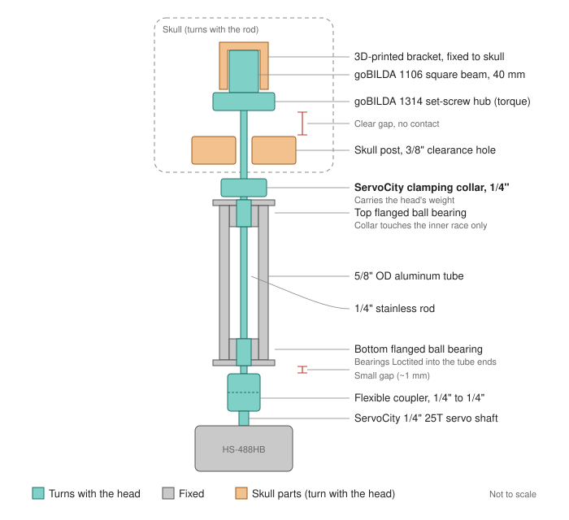

# Build guide

How the talking skull was put together, in roughly the order it was built. Part numbers are in [`hardware/BOM.md`](../hardware/BOM.md) and pin assignments in [`hardware/wiring.md`](../hardware/wiring.md).

The prop is built into an off-the-shelf plastic anatomical skeleton. The skull splits into screwed front and back halves, and the head sits on a neck post. Your skeleton will differ, so measure before cutting anything.

## 1. Know your plastic

The skull and jaw plastic floats in water and has a firm, glossy surface, which means it's a polyolefin (polypropylene or polyethylene). Most glues won't stick to it, so:

- **Hot glue plus screws** holds everything in this build. The screws carry the load and the glue fills gaps and stops rattles.
- Use **high-temp glue sticks**, flame-treat the plastic briefly before gluing, and preheat any metal parts so the glue doesn't skin over before it wets the surface.
- Hot glue softens around 60 °C, so keep the finished prop out of direct afternoon sun and hot cars or attics.
- If you want a stronger, permanent bond, 3M DP8005/DP8010 is made for polyolefins, but it's expensive.

## 2. Neck pan drivetrain

The HS-488HB sits in the ribcage and turns the head through a 1/4" rod that runs up the neck inside a fixed aluminum tube.

**Prepare the skeleton**
1. Remove the skeleton's original neck post and any screw posts that block the tube. The upper neck halves on this skeleton are screwed together, not glued, so they come apart.
2. Drill the skull post's square display-stand hole out to **3/8" round**. It's a clearance hole only: the rod passes through it without touching.

**Build the drivetrain**
1. Cut the 5/8" OD aluminum tube to length and deburr both ends inside and out.
2. Fit a flanged ball bearing into each end of the tube, flange facing out, and secure them with Loctite.
3. Cut the 1/4" stainless rod to length. File a small flat where each set screw lands (coupler, hub) so the screws grip and the rod can't slip.
4. At the bottom: 25T servo shaft into the HS-488HB, flexible coupler joining it to the rod. Leave a **~1 mm gap** between the coupler and the bottom bearing so the coupler never pushes up on it.
5. At the top: slide the **clamping collar** onto the rod where it comes out of the tube, rest it on the top bearing, and tighten it. The collar carries the head's weight, so the servo and coupler never do.
6. **Spin test:** turn the rod by hand. If it spins freely, the collar is only touching the bearing's inner race and you're done. If it drags, the collar is rubbing the bearing's outer race or flange, and you need a thin spacer that only touches the inner race (a 3D-printed ring works). On this build it spun freely with no spacer.
7. Inside the skull, fix the **set-screw hub** to the rod above the skull post, leaving a clear gap above the post. Bolt the **square beam** to the hub.
8. The beam drops into a **3D-printed bracket** fixed to the skull. A snug channel (0.1–0.2 mm clearance) carries rotation and weight, so a single horizontal screw is enough to hold it.

**Before you tighten the hub for good:** power the servo at center (1500 µs, `NECKUS 1500` from the Serial Monitor) and set the beam's orientation so the skull faces straight ahead. Then check the full pan range for anything that touches: the collar's pinch bolt, the hub and the wires.

**Wires** run up inside the hollow neck, outside the tube, with a small slack loop so they don't pull as the head turns.

> ⚠️ The HS-488HB has no mechanical stops. Neck travel is limited in firmware by `NECK_MAX_DEG` (40°). Never remove that limit.

## 3. Jaw

The HS-65MG micro servo opens the jaw through a short pushrod.

- **Bracket:** a two-piece cradle-and-cap bracket designed in Fusion 360 and printed in PETG (it tolerates the hot glue and a warm servo better than PLA). The split line is at the servo's mounting ears so the servo can come out for service. The bracket's feet are small and conform to the skull's curve, and they're hot-glued to the inside of the skull.
- **Servo screws:** the HS-65MG's ear holes take **M2** screws. 2-56 is slightly too big.
- **Jaw lever:** the skeleton's plastic jaw lever is wrapped in thin aluminum to give the linkage a solid mounting point. The wrap is hot-glued and clamped with small screws.
- **Linkage:** two Du-Bro 2-56 threaded ball links on a short 2-56 rod (cut from a 2-56 × 1" screw). Ball links have no free play, so the jaw starts moving on each syllable instead of rattling first, and the rod threads in and out to adjust the closed position.
- Aim for the pushrod to sit roughly perpendicular to both the servo horn and the jaw lever at mid-travel, so the motion stays even across the sweep.

**Calibrate** with the Serial Monitor (115200 baud): send `JAWUS 1400`, `JAWUS 2000` and values in between to find where the jaw is just closed and fully open, then set `JAW_CLOSED_US` and `JAW_OPEN_US` in the sketch. Set "closed" just before the jaw touches, so the servo never pushes against it. A stalled servo buzzes, which you'll hear on a prop whose job is talking.

## 4. Eyes

- Two 1.28" round GC9A01 displays sit behind the eye sockets, each covered by a **35 mm acrylic lens**. The lens magnifies the image slightly and gives it a wet, rounded look.
- Both displays share SPI clock, data, DC and reset; each has its own chip select. The pins are in [`wiring.md`](../hardware/wiring.md).
- They're mounted upside down, so the sketch rotates them 180°. They run at 20 MHz SPI on jumper wires; short wires may handle 40 MHz.
- The eye artwork is generated procedurally by [`tools/eyegen`](../tools/eyegen/), so it's original and free to share. The renderer runs on core 0 of the ESP32 so it never delays the servos or radar.
- If the eyes look away from visitors, flip `EYE_INVERT_X` in the sketch.

## 5. Radar

- The HLK-LD2450 reports up to three people's X/Y positions about 10 times a second, across roughly ±60°.
- Mount it in the **fixed base or chest**, not in the turning head, so its coordinates don't move when the neck turns. Keep it level, facing forward and centered below the neck's pivot.
- Radar passes through plastic but not metal. Keep metallic paint, foil and wiring out of the area in front of it.
- It needs **5 V power** but uses **3.3 V UART**, so it wires straight to the ESP32. If the Serial Monitor shows `# radar: NO DATA`, swap the RX and TX pins.
- Tune the trigger zone with `ZONE_MAX_Y` (how far out) and `ZONE_MAX_X` (how wide). If the head turns away from people, flip `NECK_INVERT`.

## 6. Audio

- **Mic:** the Seeed reSpeaker XVF3800 bare board connects to the Mac over USB. It ships with I2S firmware, so flash the **USB firmware** first, or it won't show up on the Mac. The mic openings are on the back (logo) side, so that side has to face the visitors.
- **Not hearing itself:** the XVF3800's echo cancellation needs the speaker audio as a reference, which it doesn't get with a separate amp. Instead, `skull.py` only listens while the skull isn't talking.
- **Speaker:** a Peerless PLS-P830983 2" full-range driver inside the skull, driven by a TPA3116D2 amp next to the Mac. The amp's speaker outputs are bridged, so never connect either speaker wire to ground.
- **Gain:** set the Mac's output volume high and the amp's gain low. The voice stays loud and any background noise stays quiet.
- **Buzz:** if the speaker buzzes, unplug things one at a time to find the source (the audio cable, then the ESP32's USB). A **ground-loop isolator** on the 3.5 mm cable into the amp fixes most cases. Also keep servo current out of the USB ground (see [power](../hardware/wiring.md#power)) and keep audio wires away from servo wires.

## 7. Power

Everything runs from mains; there's no battery.

- **Servos:** Triad WSU060-4000, 6 V 4 A, with a 1000 µF capacitor across the servo rail. Measure its output with a meter before connecting the servos.
- **Amp:** MEAN WELL GSM36U12-P1J, 12 V 3 A, through a 3 A fuse.
- **ESP32, radar and eyes:** USB from the Mac mini, which is also the serial link.
- Connect the servo ground to the ESP32 ground **in one place only**.

## 8. Software

Follow the [host README](../host/README.md) and [firmware README](../firmware/skull_esp32/README.md). Useful tests along the way:

| Test | Command |
|---|---|
| Claude, voice and jaw without the mic | `python skull.py --text` |
| Fake a visitor | press **Enter** in the `skull.py` window |
| List audio devices | `python skull.py --list-devices` |
| Eyes on, thinking look | `EYES 1`, then `STATE THINK` in the Serial Monitor |
| Point the eyes | `GAZE 50 -20` |
| Neck by hand / back to tracking | `NECK -20`, then `TRACK` |

The ESP32 prints a status line every 2 seconds (radar frames, whether someone is in the zone, eye frame rate) and repeats its `PRESENCE` state, so the Mac recovers if it starts late.

## Tuning the performance

All in the settings block at the top of `skull.py`:

- **Voice:** `SAY_VOICE`, `SAY_RATE`, and `PITCH_DROP` (below 1.0 makes it deeper). `skull_british.py` uses a natural-pitch British voice instead.
- **Personality:** `SYSTEM_PROMPT`, `GREETINGS` and `GOODBYES`. The skull is a theatrical, boastful villain who is secretly delighted by visitors, keeps it family friendly, compliments costumes and never asks for personal details.
- **Listening:** `END_SILENCE` (pause that ends a question) and `SPEECH_OVER_NOISE` (raise it on a noisy street).
- **Jaw sync:** `JAW_LEAD_MS` (raise it if the jaw lags the voice), `JAW_SYLLABLE_DB` (lower it to catch more syllables) and `JAW_MIN_OPEN` (raise it if quiet syllables barely move the jaw).

## Troubleshooting

| Symptom | Likely cause |
|---|---|
| Stuck at "waiting for visitor" | Check the ESP32 lines in the `skull.py` log. No `PRESENCE` lines means a wrong `--port` or the Serial Monitor is still open. Press Enter to test the rest of the chain. |
| `# radar: NO DATA` | Radar power, or RX and TX swapped |
| `eye sprite allocation failed` | Set Tools → PSRAM to **OPI PSRAM** |
| Only one eye updates | Check that each eye has its own CS pin and the shared pins go to both |
| Head turns away from people | Flip `NECK_INVERT` |
| Jaw buzzes when closed | `JAW_CLOSED_US` drives it into its stop; back it off |
| ESP32 resets when servos move | Servos are drawing from USB; give them their own supply |
| Speaker buzz or hum | See [Audio](#6-audio) |
| Whisper hears words in silence | Common phantom phrases are already filtered in `HALLUCINATIONS`; add any new ones there |
