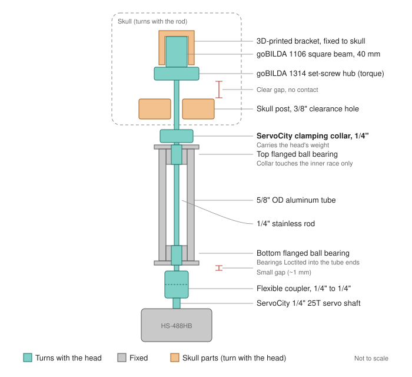

# Bill of Materials

| Qty | Part | Role | Notes |
|---|---|---|---|
| 1 | Waveshare ESP32-S3 N16R8 dev kit | Skull controller | 16 MB flash / 8 MB PSRAM; single USB-C port |
| 1 | HLK-LD2450 24 GHz mmWave radar | Presence and position tracking | UART at 256000 baud; hot-glued to the front of the spine just below the ribcage, with a clear view of visitors; wires soldered to its 4 pads and spliced to DuPont connectors |
| 2 | 1.28" GC9A01 round LCD, 240×240 SPI | Eyes | Pins RST, CS, DC, SDA, SCL, GND, VCC (no backlight pin) |
| 2 | 35 mm acrylic lens | Eyes | One over each display |
| 1 | Hitec HS-65MG micro servo | Jaw | Ball-joint linkage to the jaw lever; one-piece printed bracket |
| 1 | Hitec HS-488HB servo | Neck pan | No mechanical stops: use software limits |
| 1 | Apple Mac mini M4, 16 GB | AI/audio host | Mains-powered, hidden near the skull |
| 1 | Seeed Studio reSpeaker XVF3800 USB Microphone Array, bare board | Microphone | Connected to the Mac over USB; `--in-device ReSpeaker` matches it by name |
| 1 | TPA3116D2 amplifier board | Audio amp | Next to the Mac, powered by the 12 V adapter below |
| 1 | MEAN WELL GSM36U12-P1J (12 V, 3 A, 36 W wall adapter) | Amp power | |
| 1 | 3 A fuse and inline holder | Amp protection | On the 12 V line to the amp |
| 2 | USB-C cable, 6 ft | Mac mini links | One to the ESP32 (power and serial), one to the mic array (audio in and out) |
| 1 | 3.5 mm (1/8") stereo male plug to bare-wire audio cable, right angle, 6 ft | Audio link | Plug goes into the mic array's 3.5 mm output jack; the bare wires go to the amp's input screw terminals |
| 1 | Peerless PLS-P830983, 2" 4 Ω full-range | Speaker | Inside the skull |
| 1 | Triad Magnetics WSU060-4000 (6 V, 4 A, 24 W wall adapter) | Servo power | Regulated; 2.1 × 5.5 mm plug, center positive. Not the WSX060-4000, which has a 2.5 mm center-negative plug. Check the output with a meter before connecting the servos |
| 2 | 2.1 × 5.5 mm barrel jack to screw terminal adapter | Servo and amp power | One for the servo rail, one for the amp |
| 1 | ~1000 µF electrolytic capacitor, 10 V or higher | Servo rail | Across the servo rail near the servos, to absorb current spikes |
| — | 2-conductor 20 AWG wire | Power | From the servo supply's barrel jack to the servos, and from the 12 V barrel jack to the amp's power terminals |
| — | 2-conductor 22 AWG wire | Speaker | From the amp's output to the speaker |
| — | DuPont jumper wires | Signals | Eyes and servo signals to the ESP32 |

The ESP32 gets its power and serial link from the Mac mini's USB port, so the build no longer needs a battery or buck converters. Each part runs from its own mains adapter.

## Fasteners and consumables

| Qty | Part | Used for |
|---|---|---|
| 2 | M2 brass heat-set inserts | Jaw servo bracket; pressed into the print with a soldering iron |
| 2 | M2 screws | Jaw servo to its bracket, through one drilled-out hole in each mounting ear |
| 2 | M4 screws | Square beam to the servo hub, through beam holes 2 and 4 |
| 2 | M4 screws | Through the neck bracket halves and beam holes 1 and 5, clamping the beam in the bracket |
| 2 | M4 brass heat-set inserts | In one half of the neck bracket, for the clamping screws |
| 4 | M4 screws | Speaker to its bracket |
| 4 | M4 brass heat-set inserts | Speaker bracket; pressed into the print with a soldering iron |
| 2 | M2.6 × 10 mm self-tapping screws | Jaw servo bracket, driven up through the roof of the skull's mouth |
| — | Car-speaker sealing tape (foam gasket) | Between the speaker and its bracket, to decouple it from the skull |
| — | Double-sided tape, cut into small strips | Holding the acrylic lenses to the eye displays |
| — | High-temp hot glue sticks | Eye displays, brackets and jaw lever wrap |
| — | Loctite | Securing the flanged bearings in the aluminum tube |
| — | PLA filament | 3D-printed brackets (printed on an Elegoo Neptune 4 Max) |

## Mechanical (jaw linkage)

| Qty | Part | Brand / part no. | Notes |
|---|---|---|---|
| 2 | Threaded ball link, 2-56 | Du-Bro DUB181 | One at the servo horn, one at the jaw lever |
| 1 | 2-56 threaded rod | | Cut from a #2-56 × 1" screw; links the two ball links |

## Mechanical (neck drivetrain)

| Qty | Part | Brand / part no. | Notes |
|---|---|---|---|
| 1 | 6061-T6 drawn aluminum round tube, 5/8" OD × 0.125" wall × 0.375" ID, 1 ft | OnlineMetals | Structural spine, replaces the skeleton's neck post. Cut to about 7" |
| 1 | 0.250" (1/4") × 12.00" stainless steel precision shafting | ServoCity 2100-0250-1200 | Neck rod; carries torque only. Cut to about 8" |
| 1 pack (2) | 1/4" ID flanged ball bearing, 3/8" OD, 1/8" thick | ServoCity 1601-0001-0250 | One in each end of the aluminum tube, secured with Loctite; the rod turns in them |
| 1 | 1/4" round servo shaft, 25-tooth spline, 33 mm long | ServoCity 1911-0025-0250 | Fits the HS-488HB's 25T spline |
| 1 pack (2) | Flexible shaft coupler, 6.35 mm to 6.35 mm bore, L25 × D20 mm | uxcell | Joins the servo shaft to the 1/4" neck rod |
| 1 | 1314 Series steel set-screw hub, 1/4" bore | goBILDA 1314-0016-0250 | Fixed to the rod above the collar; the square beam bolts to it |
| 1 | 1106 Series square beam, 5 hole, 40 mm long | goBILDA 1106-0005-0040 | Bolts to the hub through holes 2 and 4; the two-piece printed neck bracket sandwiches it with M4 screws through holes 1 and 5, securing it to the skull so the skull turns with the rod |
| 1 | Aluminum clamping collar, 1/4" bore | ServoCity 2910-0001-0250 | Clamps onto the 1/4" rod where it exits the top of the aluminum tube, at the bottom of the skull, and takes the weight of the head. Sits directly on the top bearing; a spin test confirmed it turns freely, so no spacer is needed |

**How it goes together:** the rod runs up through the aluminum tube, turning in a flanged ball bearing at each end. Where it comes out at the bottom of the skull, the clamping collar grips the rod and carries the weight of the head. Above the collar, the set-screw hub is fixed to the rod, the square beam bolts to the hub through holes 2 and 4, and the two halves of a 3D-printed neck bracket sandwich the beam with M4 screws through holes 1 and 5 into heat-set inserts, and the bracket press-fits around the plastic bosses inside the skull, held by friction with no glue or screws. Two holes drilled in the back of the skull let an Allen key reach those screws.

<!-- TODO: add links/prices and anything I've missed -->
