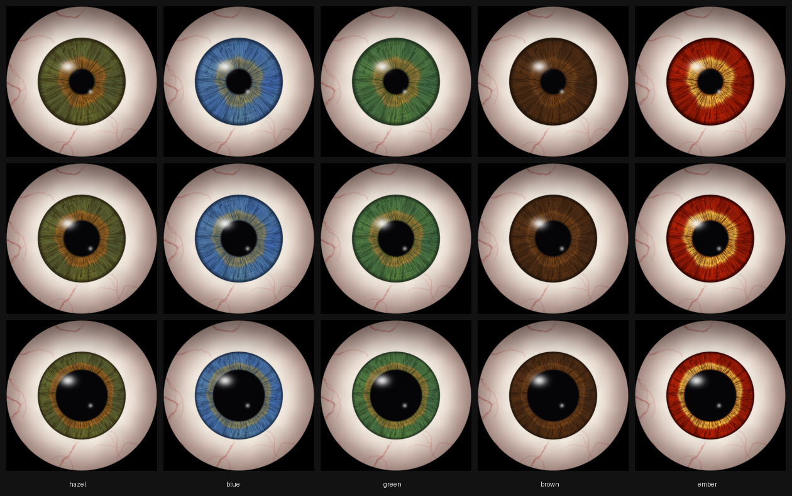
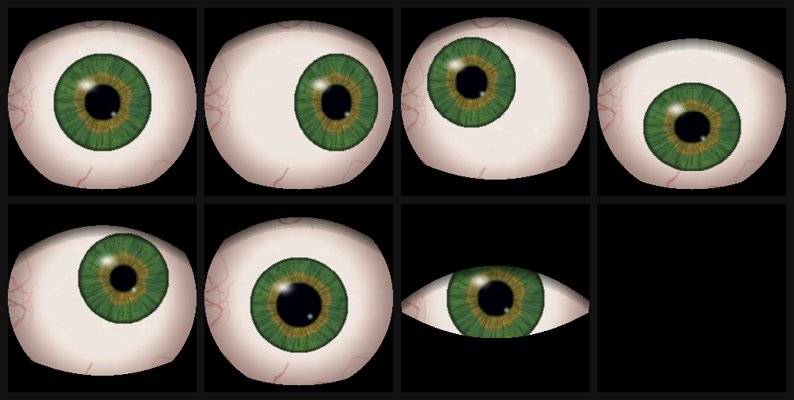

# eyegen: original eye textures

Generates the skull's eye artwork procedurally from noise and geometry: radial iris fibers, collarette, crypts, limbal ring, sclera veins, shading and corneal glints. No third-party artwork is used, so the output can be published freely under this repo's license.

```bash
pip install numpy pillow
python3 eyegen.py --seed 7 --out out/
```

- `--color`: iris color. `smolder` (dark red, the default, made for a glowing pupil), `ember` (red), `hazel`, `blue`, `green`, `brown`
- `--sclera`: `black` (the default) or `white`
- `--pupil`: `glow` (a glowing red pupil, the default) or `dark` (a normal pupil)
- `--seed`: each seed gives a different iris, so use two seeds for slightly mismatched left and right eyes

The iris is saved in polar form (`iris_polar.png`), so the firmware can dilate the pupil smoothly without distorting the iris.

## Updating the firmware eyes

The firmware ships with glowing red pupils on a black sclera, made with `--color smolder --sclera black --pupil glow --seed 7` (the defaults, plus seed 7). For natural eyes instead, for example green:

```bash
python3 eyegen.py --color green --sclera white --pupil dark --seed 7 --header ../../firmware/skull_esp32/eye_art_data.h
```
Then re-upload the sketch. `firmware/skull_esp32/eye_art.h` turns these textures into frames on the ESP32, with live pupil size, gaze, blinking, curved lids and glints.



